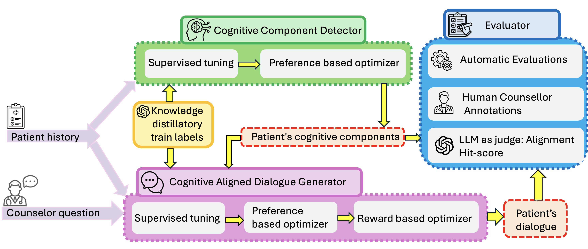

# Multi-Objective Aligned Small Language Model Framework for SUD Patient Dialogue Generation

A cognitively grounded framework for generating simulated Substance Use Disorder (SUD) patient responses consistent with patient histories, underlying cognitive states, and counselor questions. It combines knowledge distillation from larger teacher models, human-annotated preference supervision, and attention-guided reward optimization to align smaller language models.

## Framework

1. **Cognitive Component Detector (CCD):** extracts cognitive components from patient histories using supervised fine-tuning (SFT) and direct preference optimization (DPO).
2. **Cognitive Component-Aligned Dialogue Generator (CADG):** generates patient responses from the history, counselor question, and detected components using SFT, DPO, and group relative policy optimization (GRPO) with attention and length rewards.

The framework is evaluated using BERTScore, ROUGE, METEOR, BLEU, and LLM-as-judge alignment measures against human and teacher-model references.

## Code and documentation

- [CCD](CCD/README.md): detection scripts, input files, and outputs.
- [CADG](CADG/README.md): dialogue generation scripts, input files, and outputs.
- [DPO environment](dpo_env.yml) and [GRPO environment](grpo_env.yml): Conda dependency definitions.

Intended for controlled patient-simulation research, not clinical deployment or medical advice.
